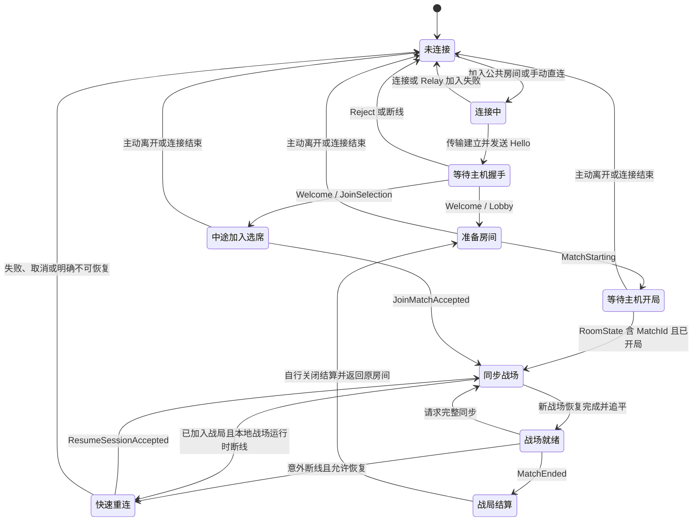
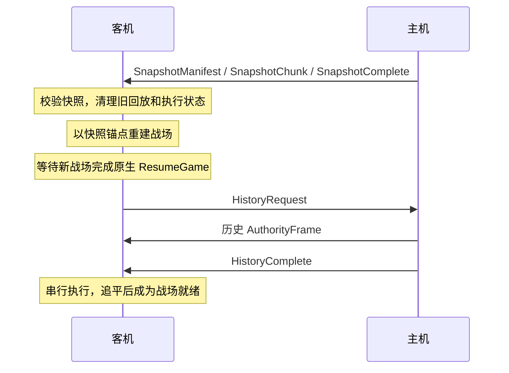
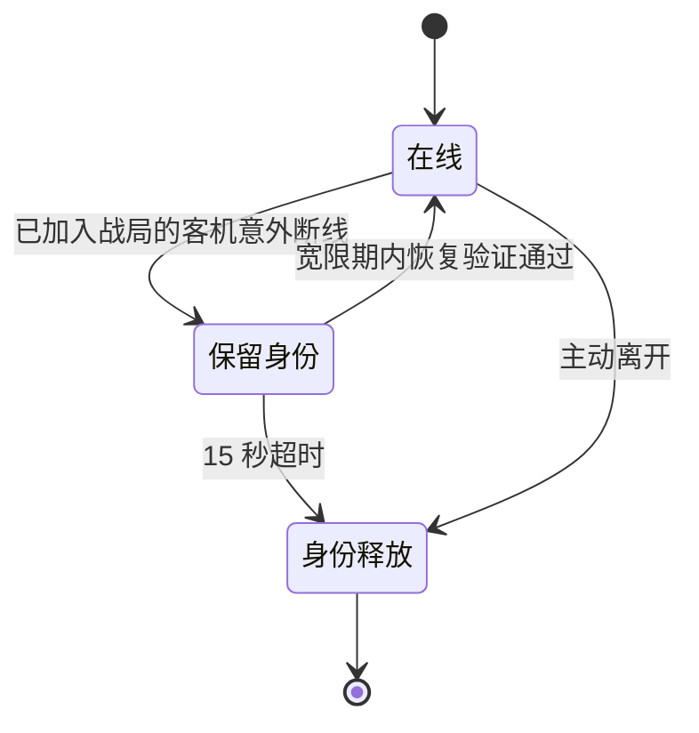

# 联机游戏与协议生命周期

本文说明建房、连接、握手、进入战场、重连和结束的整体状态，不展开游戏命令与动作执行细节。

适用基线：XingyiStarry MP 0.11.1、游戏 1.0.12、业务协议 v20。

证据：除明确标为待验证的内容外，本文为 **[静态确认]**，依据当前主插件与 Relay 源码整理；不代表所有路径均已完成双实例运行验证。

**[运行验证]** 正常终局后保留房间并再开一局，已通过本地 TCP 双实例回归：主机先返回大厅，客机仍保留结算；客机自行返回并准备后，两端进入新的战局，参与者身份保留。Relay 返回准备再开局已通过本地 C#→Go 实际连接回归。用户地图／存档房间返回及相反的结算关闭顺序仍需双实例验证。

## 1. 如何理解这些状态

实现中没有一个统管全部生命周期的枚举。下图中的中文状态是对多个字段和事件的归纳，涉及三个不同层次：

| 层次 | 负责的状态 | 决策方 |
|---|---|---|
| 传输连接 | TCP 是否建立、Relay 是否已绑定房间 | 直连传输／Relay |
| 房间会话 | 握手是否通过、参与者身份、准备、席位、会话是否结束 | 主机 |
| 本地战场 | 快照是否加载完成、是否追平、是否可以操作、是否进入结算 | 各端按主机消息推进 |

因此，“已连接”不等于“握手通过”，“进入房间”不等于“进入战场”，“恢复连接”也不等于“可以继续操作”。Relay 只负责公共房间与消息转发，游戏会话仍由主机决定。

身份的有效范围也不同：`RoomId` 标识房间，`MatchId` 标识本次战局，`ClientId` 标识参与者的逻辑会话，`SeatId` 标识战斗席位。快速重连保留原身份；重新加入走新握手，不等同于恢复旧会话。

## 2. 客机整体状态机

任何连接阶段收到 `SessionEnded` 都按终止处理，关闭会话并退出当前联机界面或战斗；图中省略了这些跨状态退出箭头。同步阶段尚未满足快速重连条件时断线，也直接退出。

### 连接与握手

| 路径 | 进入主机握手前的步骤 | 主机握手 |
|---|---|---|
| 手动直连 | 与主机 TCP 监听端口建立连接 | `Hello → Welcome / Reject` |
| 公共房间 | 与 Relay 连接，`RelayJoinRoom → RelayControlResponse` 成功，取得转发身份 | 经 Relay 转发同一套 `Hello → Welcome / Reject` |

Relay 加入成功只代表允许向主机发消息。主机仍会校验协议版本、插件版本、游戏指纹、内容指纹、房间密码和名称；这些版本／指纹要求精确匹配。房间人数已满也会拒绝。握手拒绝后，主机发送 `Reject` 并关闭该连接。

`Welcome.mode` 定义下一步入口：

| 模式 | 含义 | 当前发送情况 |
|---|---|---|
| `Lobby` | 进入未开局房间 | 主机新握手正常使用 |
| `JoinSelection` | 战局已开始，先决定席位或观战 | 主机新握手正常使用 |
| `ActiveMatch` | 已进入战局，直接请求快照 | 客机保留处理分支；当前新握手不发送此模式，快速重连使用独立回复 |

### 准备房间到进入战场

准备阶段通过 `RoomState` 同步地图、设置、席位和准备状态。参与者可以不选席准备，开局后成为观战者。

开局由主机发起，条件是所有已连接参与者准备完成。新局还要求地图有效、存在真人席位且所有配置为真人的席位已有人认领；存档房间要求地图有效，并至少有人认领一个未战败席位。

1. 主机发 `MatchStarting`，各端锁定选席、准备和房间配置。
2. 主机进入原生战场。新局等待首个玩家回合初始化完成；存档局等待原生存档恢复完成。
3. 主机绑定运行时玩家索引，创建 `MatchId` 和初始安全快照，再广播已开局的 `RoomState`。
4. 原本在准备房间的客机确定玩家／观战身份，申请快照，进入同步阶段。

`MatchStarting` 是“开局已获准、房间配置锁定”的通知，不代表战场已经可用；`Room.match_started` 与 `MatchId` 在主机建立战局后才发布。

主机的主路径为：**建房 → 准备房间 → 开局初始化 → 战局运行 → 战局结算 → 准备房间**。客机进入战场的前提是主机已经完成初始化并提供安全快照；主机不会等待所有客机加载完成才建立战局。

### 中途加入

战局已开始时，新连接完成握手后进入 `JoinSelection`，不会立即加载战场。

- 选席：先用 `ClaimSeat` 认领未战败、未占用且未处于重连保留期的席位，再发送带 `SeatId` 的 `JoinMatchRequest`。
- 观战：发送不带 `SeatId` 的 `JoinMatchRequest`；即使没有可用战斗席位，只要房间人数未满，仍可加入观战。
- 主机返回 `JoinMatchAccepted`，随后发送房间状态和安全快照。

有席位者在该席位下一次回合开始前接管；在此之前 `pending_activation=true`，仍由 AI 控制。不会中断已经开始的 AI 回合。观战者加载完成后直接观看。进入战局后不能再通过选席切换玩家／观战身份。

## 3. 同步完成与战场就绪

开局、中途加入、快速重连成功和手动完整同步，最终都汇入同一条恢复路径：

主机发送最新可用的安全快照，不一定是请求发生瞬间的战场。客机从快照记录的 `MatchId + FrameId + FrameHash` 接续历史；同步期间到达的新消息仍可接收，战场加载完成前不执行排队的权威帧。

三个完成条件必须区分：

| 条件 | 代表什么 | 是否足以放行操作 |
|---|---|---|
| 快照传输完成 | 字节已收齐并校验 | 否，仍需重建战场 |
| `IsCaughtUp=true` | 已验证接收游标达到 `HistoryComplete` 的历史水位 | 否，仍可能尚未执行完 |
| 战场恢复完成，已执行／已验证游标一致，且无执行中的回放 | 本地战场已追平 | 还须本人拥有当前行动席位，且该席位不是 AI 控制 |

“战场就绪”包括玩家和观战者，也包括非本人回合。它不等于“现在轮到我操作”。主机与客机都以实际席位和当前行动玩家判断操作权。

## 4. 意外断线与快速重连

这张图描述主机眼中的逻辑参与者。恢复到“在线”后，客机还需完成上一节的战场同步。

| 项目 | 当前行为 |
|---|---|
| 恢复资格 | 客机已有 `ClientId`、`MatchId` 且已加入战局，会话未被标记终止，本地战场仍在运行 |
| 主机保留 | 断线后保留身份和席位 15 秒；参与者标记为重连中，席位仍逻辑占用 |
| 客机重试 | 从开始重连计时，在第 0、3、7 秒尝试；每次等待窗口约 3 秒 |
| 直连恢复 | 重新连接原主机地址，然后发送 `ResumeSession` |
| Relay 恢复 | 先通过 `RelayResumeRoom` 恢复 Relay 绑定，再发送业务 `ResumeSession` |
| 主机验证 | 房间、战局和身份匹配；旧连接已进入重连状态；身份未释放且未超时 |
| 成功 | `ResumeSessionAccepted`，保留原 `ClientId`／席位，主机发送安全快照，客机重新同步 |
| 失败结束 | 尝试耗尽、用户取消、会话终止或 Relay 明确不可恢复时退出 |

主机和 Relay 各自维护恢复保留。公共房间恢复需要两层都成功，不能只凭 Relay 通过就视为游戏会话恢复。不会跨传输栈切换，也不能用快速重连抢占仍在线的身份。

准备阶段或尚未进入战局的连接断开，不保留快速恢复资格。超时或主动离开后，主机释放参与者及席位，并在安全边界通知席位转为 AI；若恰好是该席位的当前回合，结束当前回合后推进。之后重新加入属于新会话，重新握手和选席。

## 5. 战局结束与房间结束

两者使用不同通知，含义和清理时机不同：

| 事件 | 通知 | 本地结果 |
|---|---|---|
| 正常胜负判定 | 主机发送权威帧 `MatchEnded`，随后广播准备状态的 `RoomState` | 各端完成当前权威操作后进入原生结算，独立关闭结算并返回原房间；客机停止本局快速重连 |
| 主机主动中途退出战斗或退出准备房间 | 主机尽力发送 `SessionEnded`，随后关闭会话 | 客机退出联机战斗／房间，返回菜单显示结束原因 |
| Relay 发现主机连接丢失或关闭房间 | `RelayCloseRoom`，客机传输层转为 `SessionEnded` | 公共房间不可恢复，客机退出 |
| 客机主动退出 | 客机发送 `LeaveSession`；Relay 路径还尽力发送 `RelayLeaveRoom` | 本机清理；其他参与者继续，空出的战斗席位按安全边界转 AI |
| 普通网络故障 | 连接错误，无正常结束通知 | 已进入战局者先按快速重连流程处理 |

`MatchEnded` 只结束本局，不终止房间会话。主机立即把房间复位为准备状态，保留房间 ID、参与者和席位，清空所有准备状态；主机和客机仍停留在各自的原生结算画面，任何一端关闭结算都不强制其他端返回。关闭结算不发送额外消息，返回大厅后沿用 `SetReady`；所有参与者重新准备后才能开下一局。下一局生成新的 `MatchId`。没有主机迁移。

房间已回到准备状态，不代表慢客机已经执行到终局。旧局日志与安全快照保留到下一局开始，供仍在加载／追赶的原参与者取得终局；本地关闭结算时才清理客机旧局游标与回放状态。主机返回时恢复原始完整地图来源与房间设置，不能把仅供预览的网络地图数据作为主机下一局的地图。

完整退出会释放主机／客机传输，清空旧同步、回放与请求状态，复位开局、重连、输入和本地身份视角。退出原因仅在有效菜单场景显示；开始新连接时清除旧会话待发提示，避免旧退出通知出现在新房间。

## 6. Relay 的房间生命周期

Relay 状态是公共目录状态，不等于上述本地战场状态：

| 状态／事件 | 含义与转换 |
|---|---|
| `Waiting` | 注册成功后的准备房间，允许加入 |
| `Closed` | `RelayCloseJoining` 暂停新加入；房间仍存在、已有连接仍可通信，并非房间销毁 |
| `Playing` | 主机发布已开局信息，允许中途加入；也用于检查快速恢复所属战局 |
| 房间销毁 | 主机关闭、主机 Relay 连接断开或 Relay 重启，删除目录项并通知／断开相关客机 |

`RelayUpdateRoom` 允许 `Waiting → Playing`、`Closed → Playing`、`Playing → Waiting` 及各状态保持自身。回到 `Waiting` 时清除旧战局标识和重连保留，保留在线连接。`RelayCloseJoining` 是独立入口，可把现有房间标为 `Closed`，不能将它理解成终止通知。当前插件保留这个接口，正常开局路径没有调用它。

主机同时监听 TCP 并连接 Relay，两种来源共用同一个房间会话。TCP 监听失败会导致建房失败；初次 Relay 注册失败时保留直连房间。运行中 Relay 故障会终止公共房间路径，但不会结束仍正常的直连战局；当前不自动重新注册公共房间。

## 7. 协议阅读与实现边界

- 业务协议版本只在 `Hello.protocol_version` 中；`WireEnvelope` 不带版本。Relay 不解释游戏消息内部语义，不替主机判断是否已进入游戏或可以操作。
- `StartMatch(8)`、`CatchUpComplete(19)` 虽保留在消息编号表，当前会话代码没有发送／处理它们的生命周期路径。实际使用 `MatchStarting`、已开局的 `RoomState`、快照／历史完成和本地执行游标推进，不能把保留编号当作已实现的握手步骤。
- **[待验证]** 完整退出提示的双实例回归、同步途中断线和各类重连边界仍需运行验证。快照分片校验／加载异常目前不具有一套完整的自动重试、超时和回退状态机；不能从正常同步路径推断所有同步失败都会自动恢复。

维护时优先核对以下源码入口：

| 内容 | 入口 |
|---|---|
| 消息编号与身份枚举 | [ProtocolConstants.cs](../src/XingyiStarry.Mp.Protocol/ProtocolConstants.cs)、[multiplayer.proto](../src/XingyiStarry.Mp.Protocol/Protos/multiplayer.proto) |
| 主机握手、准入、身份保留 | [HostSession.cs](../src/XingyiStarry.Mp/Session/HostSession.cs)、[HandshakeValidator.cs](../src/XingyiStarry.Mp/Session/HandshakeValidator.cs) |
| 选席、准备与开局资格 | [RoomState.cs](../src/XingyiStarry.Mp/Session/RoomState.cs) |
| 客机消息驱动与同步游标 | [ClientSession.cs](../src/XingyiStarry.Mp/Session/ClientSession.cs) |
| 原生战场边界、重连调度与退出清理 | [XingyiStarryMpPlugin.cs](../src/XingyiStarry.Mp/XingyiStarryMpPlugin.cs) |
| Relay 绑定与终止通知转换 | [RelayTransport.cs](../src/XingyiStarry.Mp/Infrastructure/RelayTransport.cs) |

Relay 服务端对应相邻 `xingyistarry-mp-relay` 仓库的 `internal/server/server.go` 与 `connection.go`。
